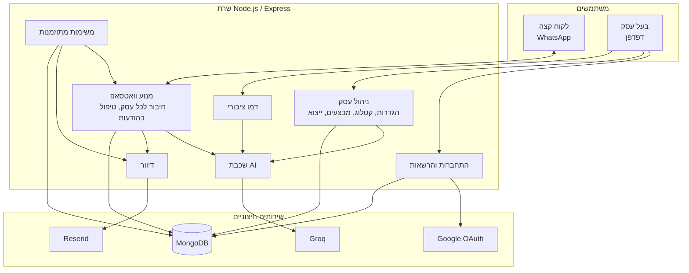
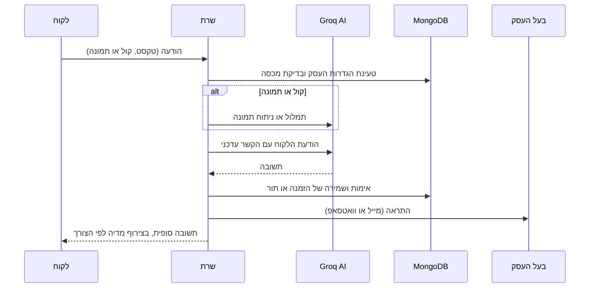

# ארכיטקטורה

[חזרה לעמוד הראשי](../README.md)

## סקירה

BotShop היא אפליקציית Node.js/Express אחת, שמגישה גם את ה-API וגם את ממשק המשתמש. לכל עסק יש חיבור וואטסאפ פעיל משלו, וכל הנתונים הקבועים נשמרים ב-MongoDB.

## רכיבי המערכת

| רכיב | אחריות |
|---|---|
| התחברות | Google OAuth, ניהול הרשאות, בחירת מסלול וסוג עסק, מחיקת חשבון |
| ניהול עסק | שמירת הגדרות וקטלוג, העלאת מדיה, חיבור וואטסאפ, שליחת מבצעים, ייצוא נתונים |
| מנוע וואטסאפ | ניהול החיבורים, טיפול בהודעות נכנסות, תזכורות, סטטוסים ומבצעים |
| שכבת AI | שיחה, ניתוח תמונות, תמלול קולי, ניהול מפתחות |
| הזמנות ותורים | אימות מול הקטלוג, ניהול מלאי, חישוב שעות פנויות |
| דוחות | סטטיסטיקה יומית, סיכומים וריכוזי התראות |
| מדיה | עיבוד תמונות וסרטונים, הורדה מקישור בצורה מאובטחת |
| דמו ציבורי | בוט לדוגמה בדף הנחיתה, מבודד מהמערכת האמיתית ומוגבל בעלות |

## טיפול בהודעה נכנסת

## משימות רקע

תזכורות לתורים, סיכומים יומיים, ריכוזי התראות, בקשות הסכמה לדיוור, מעקב אחר שיחות שלא הושלמו, פרסום סטטוסים ושימור נתונים. כל המשימות מוגנות מפני ריצה כפולה, וכל חישובי הזמן לפי שעון ישראל.

## פריסה

- תהליך יחיד תחת PM2 עם אתחול אוטומטי.
- שרת Reverse Proxy עם HTTPS, ואחסון קבוע למדיה ולנתוני החיבור.
- נקודת `/health` לשירותי ניטור.
- לגידול: כמה שרתים נפרדים, שכל אחד מהם משרת קבוצת עסקים.

